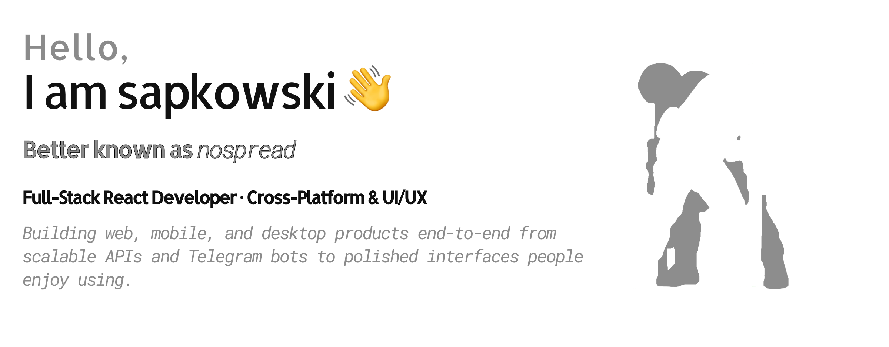

<picture>
  <source media="(prefers-color-scheme: dark)" srcset="assets/hello.png">
  
</picture>

 

##  Focus Areas

<table>
  <tr>
    <td width="50%" valign="top">
      <h3> Full-Stack Web</h3>
      
End-to-end web applications with modern React ecosystems, SSR/SSG, state management, and responsive design systems.

      

    </td>
    <td width="50%" valign="top">
      <h3> Mobile &amp; Desktop</h3>
      
Cross-platform native-feel applications for iOS, Android, macOS, and Windows built from shared TypeScript codebases.

      

    </td>
  </tr>
  <tr>
    <td width="50%" valign="top">
      <h3> API, Backend &amp; Bots</h3>
      
Scalable REST &amp; GraphQL APIs, WebSockets, database architecture, AI integrations, and automated Telegram / Discord bots.

      

    </td>
    <td width="50%" valign="top">
      <h3> UI/UX &amp; Graphics</h3>
      
Interface prototyping, vector graphics, motion/micro-interactions, and visual assets tailored for product consistency.

      

    </td>
  </tr>
</table>

 

##  Stack

<table>
  <tr>
    <td><b>Languages</b></td>
    <td>
      <a href="https://www.typescriptlang.org/"><picture><source media="(prefers-color-scheme: dark)" srcset="https://shieldcn.dev/badge/TypeScript.svg?variant=secondary&font=geist&logo=typescript&mode=dark"></picture></a>
      <a href="https://developer.mozilla.org/docs/Web/JavaScript"><picture><source media="(prefers-color-scheme: dark)" srcset="https://shieldcn.dev/badge/JavaScript.svg?variant=secondary&font=geist&logo=javascript&mode=dark"></picture></a>
      <a href="https://www.python.org/"><picture><source media="(prefers-color-scheme: dark)" srcset="https://shieldcn.dev/badge/Python.svg?variant=secondary&font=geist&logo=python&mode=dark"></picture></a>
      <a href="https://www.postgresql.org/"><picture><source media="(prefers-color-scheme: dark)" srcset="https://shieldcn.dev/badge/SQL.svg?variant=secondary&font=geist&logo=lu:Database&mode=dark"></picture></a>
      <a href="https://html.spec.whatwg.org/"><picture><source media="(prefers-color-scheme: dark)" srcset="https://shieldcn.dev/badge/HTML%20%2F%20CSS.svg?variant=secondary&font=geist&logo=html5&mode=dark"></picture></a>
    </td>
  </tr>
  <tr>
    <td><b>Frontend</b></td>
    <td>
      <a href="https://react.dev/"><picture><source media="(prefers-color-scheme: dark)" srcset="https://shieldcn.dev/badge/React.svg?variant=secondary&font=geist&logo=react&mode=dark"></picture></a>
      <a href="https://nextjs.org/"><picture><source media="(prefers-color-scheme: dark)" srcset="https://shieldcn.dev/badge/Next.js.svg?variant=secondary&font=geist&logo=nextdotjs&mode=dark"></picture></a>
      <a href="https://tailwindcss.com/"><picture><source media="(prefers-color-scheme: dark)" srcset="https://shieldcn.dev/badge/Tailwind%20CSS.svg?variant=secondary&font=geist&logo=tailwindcss&mode=dark"></picture></a>
      <a href="https://vite.dev/"><picture><source media="(prefers-color-scheme: dark)" srcset="https://shieldcn.dev/badge/Vite.svg?variant=secondary&font=geist&logo=vite&mode=dark"></picture></a>
      <a href="https://redux-toolkit.js.org/"><picture><source media="(prefers-color-scheme: dark)" srcset="https://shieldcn.dev/badge/Redux%20%2F%20Zustand.svg?variant=secondary&font=geist&logo=redux&mode=dark"></picture></a>
    </td>
  </tr>
  <tr>
    <td><b>Backend &amp; API</b></td>
    <td>
      <a href="https://nodejs.org/"><picture><source media="(prefers-color-scheme: dark)" srcset="https://shieldcn.dev/badge/Node.js.svg?variant=secondary&font=geist&logo=nodedotjs&mode=dark"></picture></a>
      <a href="https://nestjs.com/"><picture><source media="(prefers-color-scheme: dark)" srcset="https://shieldcn.dev/badge/NestJS.svg?variant=secondary&font=geist&logo=nestjs&mode=dark"></picture></a>
      <a href="https://expressjs.com/"><picture><source media="(prefers-color-scheme: dark)" srcset="https://shieldcn.dev/badge/Express.svg?variant=secondary&font=geist&logo=express&mode=dark"></picture></a>
      <a href="https://fastapi.tiangolo.com/"><picture><source media="(prefers-color-scheme: dark)" srcset="https://shieldcn.dev/badge/FastAPI.svg?variant=secondary&font=geist&logo=fastapi&mode=dark"></picture></a>
      <a href="https://graphql.org/"><picture><source media="(prefers-color-scheme: dark)" srcset="https://shieldcn.dev/badge/REST%20%2F%20GraphQL.svg?variant=secondary&font=geist&logo=graphql&mode=dark"></picture></a>
      <a href="https://www.postgresql.org/"><picture><source media="(prefers-color-scheme: dark)" srcset="https://shieldcn.dev/badge/PostgreSQL.svg?variant=secondary&font=geist&logo=postgresql&mode=dark"></picture></a>
      <a href="https://www.prisma.io/"><picture><source media="(prefers-color-scheme: dark)" srcset="https://shieldcn.dev/badge/Prisma.svg?variant=secondary&font=geist&logo=prisma&mode=dark"></picture></a>
      <a href="https://redis.io/"><picture><source media="(prefers-color-scheme: dark)" srcset="https://shieldcn.dev/badge/Redis.svg?variant=secondary&font=geist&logo=redis&mode=dark"></picture></a>
    </td>
  </tr>
  <tr>
    <td><b>Bots &amp; Automation</b></td>
    <td>
      <a href="https://core.telegram.org/bots/api"><picture><source media="(prefers-color-scheme: dark)" srcset="https://shieldcn.dev/badge/Telegram%20Bot%20API.svg?variant=secondary&font=geist&logo=telegram&mode=dark"></picture></a>
      <a href="https://aiogram.dev/"><picture><source media="(prefers-color-scheme: dark)" srcset="https://shieldcn.dev/badge/aiogram.svg?variant=secondary&font=geist&logo=python&mode=dark"></picture></a>
      <a href="https://grammy.dev/"><picture><source media="(prefers-color-scheme: dark)" srcset="https://shieldcn.dev/badge/grammY.svg?variant=secondary&font=geist&logo=lu:Bot&mode=dark"></picture></a>
      <a href="https://discord.js.org/"><picture><source media="(prefers-color-scheme: dark)" srcset="https://shieldcn.dev/badge/Discord.js.svg?variant=secondary&font=geist&logo=discord&mode=dark"></picture></a>
    </td>
  </tr>
  <tr>
    <td><b>Mobile &amp; Desktop</b></td>
    <td>
      <a href="https://reactnative.dev/"><picture><source media="(prefers-color-scheme: dark)" srcset="https://shieldcn.dev/badge/React%20Native.svg?variant=secondary&font=geist&logo=react&mode=dark"></picture></a>
      <a href="https://expo.dev/"><picture><source media="(prefers-color-scheme: dark)" srcset="https://shieldcn.dev/badge/Expo.svg?variant=secondary&font=geist&logo=expo&mode=dark"></picture></a>
      <a href="https://www.electronjs.org/"><picture><source media="(prefers-color-scheme: dark)" srcset="https://shieldcn.dev/badge/Electron.svg?variant=secondary&font=geist&logo=electron&mode=dark"></picture></a>
      <a href="https://tauri.app/"><picture><source media="(prefers-color-scheme: dark)" srcset="https://shieldcn.dev/badge/Tauri.svg?variant=secondary&font=geist&logo=tauri&mode=dark"></picture></a>
    </td>
  </tr>
  <tr>
    <td><b>Design &amp; Graphics</b></td>
    <td>
      <a href="https://www.figma.com/"><picture><source media="(prefers-color-scheme: dark)" srcset="https://shieldcn.dev/badge/Figma.svg?variant=secondary&font=geist&logo=figma&mode=dark"></picture></a>
    </td>
  </tr>
  <tr>
    <td><b>AI</b></td>
    <td>
      <a href="https://claude.ai/"><picture><source media="(prefers-color-scheme: dark)" srcset="https://shieldcn.dev/badge/Claude.svg?variant=secondary&font=geist&logo=claude&mode=dark"></picture></a>
      <a href="https://openai.com/codex/"><picture><source media="(prefers-color-scheme: dark)" srcset="https://shieldcn.dev/badge/ChatGPT%20Codex.svg?variant=secondary&font=geist&logo=ri:RiOpenaiFill&mode=dark"></picture></a>
    </td>
  </tr>
  <tr>
    <td><b>IDEs &amp; Tools</b></td>
    <td>
      <a href="https://code.visualstudio.com/"><picture><source media="(prefers-color-scheme: dark)" srcset="https://shieldcn.dev/badge/VS%20Code.svg?variant=secondary&font=geist&logo=visualstudiocode&mode=dark"></picture></a>
      <a href="https://www.jetbrains.com/webstorm/"><picture><source media="(prefers-color-scheme: dark)" srcset="https://shieldcn.dev/badge/WebStorm.svg?variant=secondary&font=geist&logo=webstorm&mode=dark"></picture></a>
      <a href="https://git-scm.com/"><picture><source media="(prefers-color-scheme: dark)" srcset="https://shieldcn.dev/badge/Git.svg?variant=secondary&font=geist&logo=git&mode=dark"></picture></a>
      <a href="https://www.docker.com/"><picture><source media="(prefers-color-scheme: dark)" srcset="https://shieldcn.dev/badge/Docker.svg?variant=secondary&font=geist&logo=docker&mode=dark"></picture></a>
      <a href="https://www.postman.com/"><picture><source media="(prefers-color-scheme: dark)" srcset="https://shieldcn.dev/badge/Postman.svg?variant=secondary&font=geist&logo=postman&mode=dark"></picture></a>
      <a href="https://www.apple.com/macos/"><picture><source media="(prefers-color-scheme: dark)" srcset="https://shieldcn.dev/badge/macOS.svg?variant=secondary&font=geist&logo=apple&mode=dark"></picture></a>
    </td>
  </tr>
</table>

 

---

Most of my production work lives in private repositories · Open for interesting projects &amp; collaborations

